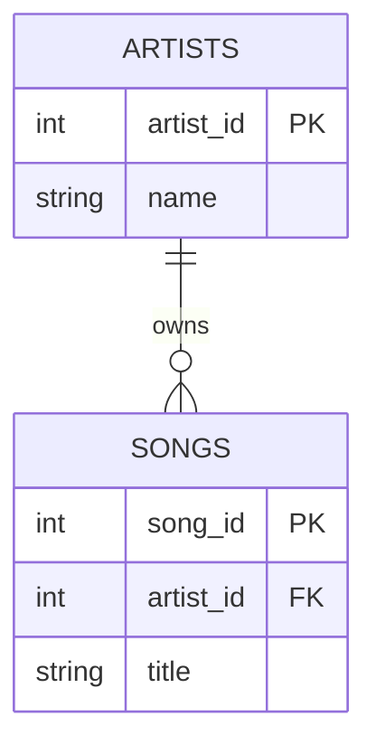
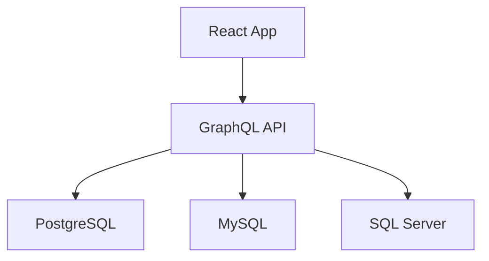
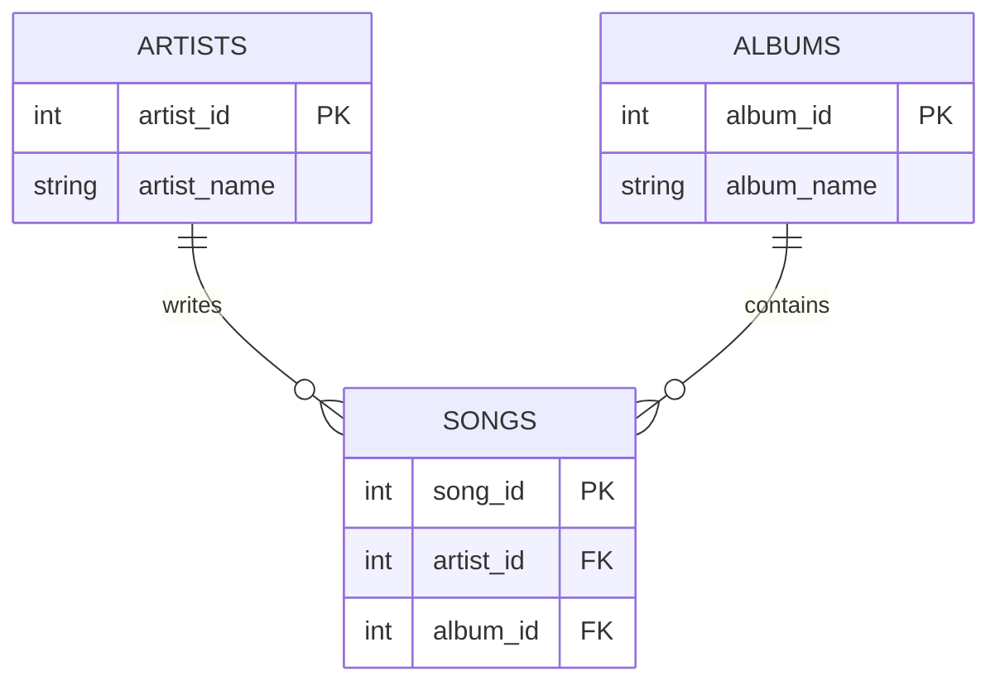

# 📚 INFORMATION_SCHEMA - The Complete Mental Model (Feynman Style)

> **One-Sentence Summary**
>
> `INFORMATION_SCHEMA` is a special set of system views that lets you query the **database's metadata** (information about tables, columns, relationships, constraints, views, procedures, etc.) using SQL.

---

# 📑 INDEX

## Part 1: Foundations

- [1. What is Metadata?](#1-what-is-metadata)
- [2. What is INFORMATION_SCHEMA?](#2-what-is-information_schema)
- [3. Why Does INFORMATION_SCHEMA Exist?](#3-why-does-information_schema-exist)
- [4. Data vs Metadata](#4-data-vs-metadata)
- [5. The Library Analogy](#5-the-library-analogy)

---

## Part 2: Internal Architecture

- [6. Where Is INFORMATION_SCHEMA Stored?](#6-where-is-information_schema-stored)
- [7. System Catalogs vs INFORMATION_SCHEMA](#7-system-catalogs-vs-information_schema)
- [8. How INFORMATION_SCHEMA Works Behind the Scenes](#8-how-information_schema-works-behind-the-scenes)

---

## Part 3: INFORMATION_SCHEMA Objects

- [9. INFORMATION_SCHEMA.TABLES](#9-information_schematables)
- [10. INFORMATION_SCHEMA.COLUMNS](#10-information_schemacolumns)
- [11. INFORMATION_SCHEMA.VIEWS](#11-information_schemaviews)
- [12. INFORMATION_SCHEMA.TABLE_CONSTRAINTS](#12-information_schematable_constraints)
- [13. INFORMATION_SCHEMA.KEY_COLUMN_USAGE](#13-information_schemakey_column_usage)
- [14. INFORMATION_SCHEMA.REFERENTIAL_CONSTRAINTS](#14-information_schemareferential_constraints)
- [15. INFORMATION_SCHEMA.CHECK_CONSTRAINTS](#15-information_schemacheck_constraints)
- [16. INFORMATION_SCHEMA.ROUTINES](#16-information_schemaroutines)
- [17. INFORMATION_SCHEMA.PARAMETERS](#17-information_schemaparameters)
- [18. INFORMATION_SCHEMA.SCHEMATA](#18-information_schemaschemata)
- [19. INFORMATION_SCHEMA.DOMAINS](#19-information_schemadomains)
- [20. Other INFORMATION_SCHEMA Objects](#20-other-information_schema-objects)

---

## Part 4: Database Support

- [21. Is INFORMATION_SCHEMA SQL Standard?](#21-is-information_schema-sql-standard)
- [22. SQL Server Support](#22-sql-server-support)
- [23. PostgreSQL Support](#23-postgresql-support)
- [24. MySQL Support](#24-mysql-support)
- [25. SQLite Support](#25-sqlite-support)
- [26. Oracle Support](#26-oracle-support)
- [27. GraphQL Support](#27-graphql-support)

---

## Part 5: Real World Use Cases

- [28. Discovering a New Database](#28-discovering-a-new-database)
- [29. Building ER Diagrams Automatically](#29-building-er-diagrams-automatically)
- [30. Schema Auditing](#30-schema-auditing)
- [31. Dynamic Applications](#31-dynamic-applications)

---

## Part 6: Cheat Sheet

- [32. Most Important Queries](#32-most-important-queries)

---

# 1. What is Metadata?

Before understanding `INFORMATION_SCHEMA`, you must understand **metadata**.

Metadata means:

> Data that describes other data.

Example:

Table:

```sql
songs
```

Contains:

```text
Song Name
Artist
Duration
Release Date
```

Actual data:

```text
Hello
Adele
295
2015
```

Metadata:

```text
Table Name = songs
Column Name = artist
Column Type = VARCHAR(100)
Nullable = No
```

---

# 2. What is INFORMATION_SCHEMA?

`INFORMATION_SCHEMA` is a collection of read-only views that expose database metadata.

Think:

```text
Database
│
├── Your Tables
├── Your Views
├── Your Procedures
└── INFORMATION_SCHEMA
```

The database stores information about itself.

You can query that information using SQL.

Example:

```sql
SELECT *
FROM INFORMATION_SCHEMA.TABLES;
```

This returns information about tables.

---

# 3. Why Does INFORMATION_SCHEMA Exist?

Imagine joining a new company.

The database contains:

```text
1200 tables
350 views
500 procedures
```

No human can inspect those manually.

Instead:

```sql
SELECT *
FROM INFORMATION_SCHEMA.TABLES;
```

The database gives you a map.

---

# 4. Data vs Metadata

## Data

```sql
SELECT *
FROM songs;
```

Returns:

```text
Hello
Adele
295
```

---

## Metadata

```sql
SELECT *
FROM INFORMATION_SCHEMA.COLUMNS;
```

Returns:

```text
songs
title
varchar
```

Notice:

```text
songs table = Business Data

INFORMATION_SCHEMA = Data About Business Data
```

---

# 5. The Library Analogy

Imagine a giant library.

```text
Library
│
├── Book A
├── Book B
├── Book C
```

The books contain information.

But the library also has a catalog:

```text
Book Name
Author
Location
Category
```

That catalog is metadata.

---

### Database Equivalent

```text
Books
=
Tables

Library Catalog
=
INFORMATION_SCHEMA
```

---

# 6. Where Is INFORMATION_SCHEMA Stored?

Many beginners think:

```text
 INFORMATION_SCHEMA is a table
```

Not exactly.

Usually:

```text
Database Engine
        │
        ▼
System Catalogs
        │
        ▼
INFORMATION_SCHEMA Views
        │
        ▼
Your Query
```

---

# 7. System Catalogs vs INFORMATION_SCHEMA

Think of it this way:

```text
Actual Metadata
        │
        ▼
System Catalog
        │
        ▼
Friendly Standard Layer
        │
        ▼
INFORMATION_SCHEMA
```

ASCII Diagram:

```text
+----------------------+
| Internal Metadata    |
+----------------------+
           |
           v
+----------------------+
| System Catalogs      |
+----------------------+
           |
           v
+----------------------+
| INFORMATION_SCHEMA   |
+----------------------+
           |
           v
+----------------------+
| Your SQL Query       |
+----------------------+
```

---

# 8. How INFORMATION_SCHEMA Works Behind the Scenes

Suppose:

```sql
CREATE TABLE songs
(
   song_id   INT,
   title     VARCHAR(100),
   artist    VARCHAR(100)
);
```

Database internally records:

```text
Table = songs
Column = song_id
Type = INT

Table = songs
Column = title
Type = VARCHAR
```

When you query:

```sql
SELECT *
FROM INFORMATION_SCHEMA.COLUMNS;
```

The database returns those records.

---

# 9. INFORMATION_SCHEMA.TABLES

Shows all tables.

Query:

```sql
SELECT *
FROM INFORMATION_SCHEMA.TABLES;
```

Example output:

```text
songs
artists
albums
users
```

Useful when:

- Joining a new project
- Exploring a database
- Finding table names

---

# 10. INFORMATION_SCHEMA.COLUMNS

Most commonly used object.

Shows every column of every table.

Query:

```sql
SELECT *
FROM INFORMATION_SCHEMA.COLUMNS;
```

Example:

```text
TABLE_NAME   COLUMN_NAME   DATA_TYPE

songs        song_id       int
songs        title         varchar
songs        artist        varchar

albums       album_id      int
albums       name          varchar
```

---

### To Find Columns in One Table

```sql
SELECT COLUMN_NAME
FROM INFORMATION_SCHEMA.COLUMNS
WHERE TABLE_NAME = 'songs';
```

Result:

```text
song_id
title
artist
```

---

# 11. INFORMATION_SCHEMA.VIEWS

Shows database views.

Query:

```sql
SELECT *
FROM INFORMATION_SCHEMA.VIEWS;
```

Example:

```text
TopSongs
ActiveUsers
MonthlyRevenue
```

---

# 12. INFORMATION_SCHEMA.TABLE_CONSTRAINTS

Shows constraints.

Query:

```sql
SELECT *
FROM INFORMATION_SCHEMA.TABLE_CONSTRAINTS;
```

Output:

```text
PRIMARY KEY
FOREIGN KEY
UNIQUE
CHECK
```

---

Example:

```sql
CREATE TABLE songs
(
  song_id INT PRIMARY KEY,
  title VARCHAR(100)
);
```

Metadata:

```text
PK_songs
PRIMARY KEY
```

---

# 13. INFORMATION_SCHEMA.KEY_COLUMN_USAGE

Shows columns participating in keys.

Query:

```sql
SELECT *
FROM INFORMATION_SCHEMA.KEY_COLUMN_USAGE;
```

Example:

```text
songs.song_id
albums.album_id
artists.artist_id
```

Useful for identifying:

- Primary keys
- Foreign keys

---

# 14. INFORMATION_SCHEMA.REFERENTIAL_CONSTRAINTS

Shows table relationships.

Example:

```text
songs.artist_id
      │
      ▼
artists.artist_id
```

Mermaid:



Query:

```sql
SELECT *
FROM INFORMATION_SCHEMA.REFERENTIAL_CONSTRAINTS;
```

---

# 15. INFORMATION_SCHEMA.CHECK_CONSTRAINTS

Shows validation rules.

Example:

```sql
CHECK (duration > 0)
```

Metadata:

```text
duration must be > 0
```

Query:

```sql
SELECT *
FROM INFORMATION_SCHEMA.CHECK_CONSTRAINTS;
```

---

# 16. INFORMATION_SCHEMA.ROUTINES

Shows:

- Stored Procedures
- Functions

Query:

```sql
SELECT *
FROM INFORMATION_SCHEMA.ROUTINES;
```

Output:

```text
GetSong
AddSong
DeleteSong
CalculateRevenue
```

---

# 17. INFORMATION_SCHEMA.PARAMETERS

Shows procedure/function parameters.

Suppose:

```sql
GetSong(song_id INT)
```

Query:

```sql
SELECT *
FROM INFORMATION_SCHEMA.PARAMETERS;
```

Output:

```text
song_id
int
INPUT
```

---

# 18. INFORMATION_SCHEMA.SCHEMATA

Shows schemas.

Think:

```text
Database
│
├── Sales Schema
├── HR Schema
└── Finance Schema
```

Query:

```sql
SELECT *
FROM INFORMATION_SCHEMA.SCHEMATA;
```

---

# 19. INFORMATION_SCHEMA.DOMAINS

Domains are reusable custom types.

Example:

```sql
EmailAddress
PhoneNumber
```

Query:

```sql
SELECT *
FROM INFORMATION_SCHEMA.DOMAINS;
```

Supported better in PostgreSQL than many other systems.

---

# 20. Other INFORMATION_SCHEMA Objects

Depending on DB:

```text
ASSERTIONS
CHARACTER_SETS
COLLATIONS
COLUMN_``text
Postgres -> INFORMATION_SCHEMA

SQL Server -> INFORMATION_SCHEMA

MySQL -> INFORMATION_SCHEMA

SQLite -> PRAGMA
```

---

# 26. Oracle Support

Oracle uses its own catalog views.

Examples:

```sql
USER_TABLES
USER_TAB_COLUMNS
ALL_TABLES
DBA_TABLES
```

Equivalent of:

```sql
INFORMATION_SCHEMA.COLUMNS
```

would be:

```sql
USER_TAB_COLUMNS
```

---

# 27. GraphQL Support

This is where many developers get confused.

GraphQL is NOT a database.

GraphQL is:

```text
API Query Language
```

Architecture:

```text
Frontend
    │
    ▼
GraphQL
    │
    ▼
Database
```

Mermaid:



GraphQL itself does NOT expose INFORMATION_SCHEMA.

But the database behind GraphQL might.

---

# 28. Discovering a New Database

First thing experienced developers do:

```sql
SELECT *
FROM INFORMATION_SCHEMA.TABLES;
```

Find tables.

---

Then:

```sql
SELECT *
FROM INFORMATION_SCHEMA.COLUMNS;
```

Find columns.

---

Then:

```sql
SELECT *
FROM INFORMATION_SCHEMA.KEY_COLUMN_USAGE;
```

Find keys.

---

Then:

```sql
SELECT *
FROM INFORMATION_SCHEMA.REFERENTIAL_CONSTRAINTS;
```

Find relationships.

---

Within 15 minutes:

```text
Database Structure Understood
```

---

# 29. Building ER Diagrams Automatically

Tools often read:

```text
TABLES
COLUMNS
REFERENTIAL_CONSTRAINTS
```

and automatically create diagrams.

Mermaid example:



---

# 30. Schema Auditing

Example questions:

- Which columns allow NULL?
- Which tables have no primary key?
- Which foreign keys exist?
- Which procedures use a table?

All possible through metadata.

---

# 31. Dynamic Applications

Many admin tools work like this:

```text
Read INFORMATION_SCHEMA
        │
        ▼
Detect Tables
        │
        ▼
Detect Columns
        │
        ▼
Generate UI Automatically
```

Flowchart:

```text
+----------------------+
| INFORMATION_SCHEMA   |
+----------------------+
            |
            v
+----------------------+
| Read Metadata        |
+----------------------+
            |
            v
+----------------------+
| Generate Forms       |
+----------------------+
            |
            v
+----------------------+
| Generate Screens     |
+----------------------+
```

---

# 32. Most Important Queries

## List All Tables

```sql
SELECT *
FROM INFORMATION_SCHEMA.TABLES;
```

---

## List All Columns

```sql
SELECT *
FROM INFORMATION_SCHEMA.COLUMNS;
```

---

## List Columns of One Table

```sql
SELECT COLUMN_NAME
FROM INFORMATION_SCHEMA.COLUMNS
WHERE TABLE_NAME = 'songs';
```

---

## Find Primary Keys

```sql
SELECT *
FROM INFORMATION_SCHEMA.KEY_COLUMN_USAGE;
```

---

## Find Constraints

```sql
SELECT *
FROM INFORMATION_SCHEMA.TABLE_CONSTRAINTS;
```

---

## Find Relationships

```sql
SELECT *
FROM INFORMATION_SCHEMA.REFERENTIAL_CONSTRAINTS;
```

---

# 🎯 Final Mental Model

Never memorize the queries first.

Memorize this concept:

```text
Business Data
     │
     ▼
Tables
     │
     ▼
Metadata
     │
     ▼
INFORMATION_SCHEMA
```

Another way:

```text
Library Books
        =
Tables

Library Catalog
        =
INFORMATION_SCHEMA
```

You don't open every book to understand the library.

You query the catalog.

Similarly:

You don't inspect every table manually.

You query `INFORMATION_SCHEMA`.

That single idea is the key to understanding the entire metadata system in SQL databases.